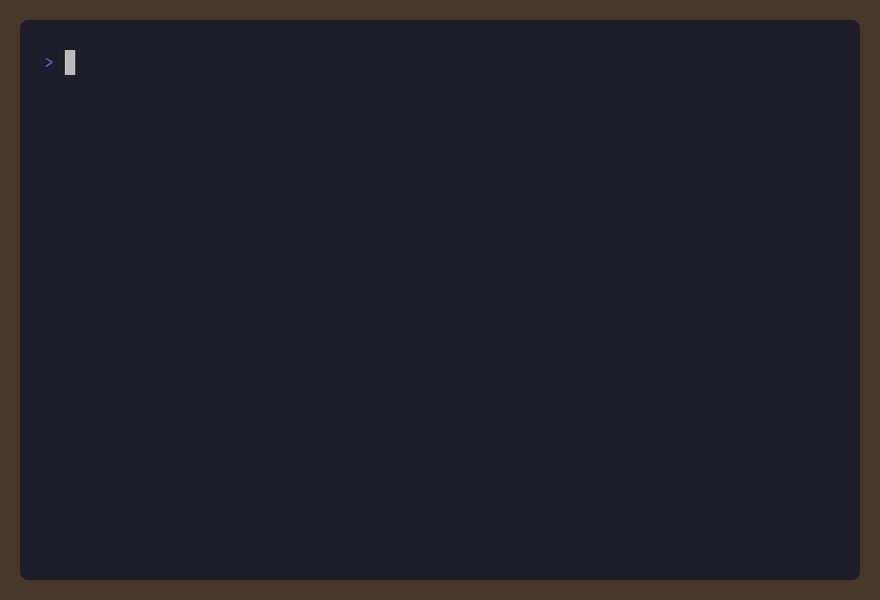

# WOLS - WeMush Open Labeling Standard

[](https://www.python.org/downloads/)
[](https://opensource.org/licenses/Apache-2.0)

The official Python implementation of the WeMush Open Labeling Standard (WOLS) v1.3.0 for specimen tracking in mushroom cultivation. It passes every case in the [WOLS conformance vectors](https://github.com/wemush/open-standard/tree/main/conformance) (see [`tests/conformance/`](tests/conformance/README.md)).

> **Upgrading from 1.2?** The encrypted format changed in 1.3.0 and is not compatible with 1.2.x output. See [Upgrading from 1.2](#upgrading-from-12).



## Features

- **Core Module**: Create, parse, validate, and serialize specimen labels
- **QR Codes**: Generate and scan QR codes (PNG, SVG, base64)
- **Encryption**: WOLS 1.3.0 encrypted labels (AES-256-GCM, passphrase or raw key)
- **Signatures**: Ed25519 signing and verification of embedded labels and
  encrypted URLs (WOLS 1.4.0 release candidate)
- **CLI**: Command-line interface for all operations
- **Type Safe**: Full type annotations with PEP 561 support
- **Interop**: CI round-trips encrypted labels (URL `kdf=pbkdf2`/`kdf=raw` and field-level) with the TypeScript [`@wemush/wols`](https://github.com/wemush/specimen-labels-js) library in both directions, against its npm release and its `main` branch (see [`interop/`](interop/))

## Installation

### Basic Installation (Core Only)

```bash
# Using UV (recommended)
uv add wols

# Using pip
pip install wols
```

### With Optional Features

```bash
# QR code support
uv add "wols[qr]"

# CLI support
uv add "wols[cli]"

# Encryption support
uv add "wols[crypto]"

# Everything
uv add "wols[all]"
```

### Requirements

- Python 3.12 or later
- No required dependencies for core module

### Container Image

The WOLS CLI is also available as a container image:

```bash
# Pull the latest image
docker pull ghcr.io/wemush/specimen-labels-py:latest

# Run the CLI
docker run --rm ghcr.io/wemush/specimen-labels-py --version

# Create a specimen
docker run --rm ghcr.io/wemush/specimen-labels-py create \
  --species "Pleurotus ostreatus" \
  --type SUBSTRATE \
  --json

# Validate a specimen (mount local file)
docker run --rm -v $(pwd):/data ghcr.io/wemush/specimen-labels-py \
  validate /data/specimen.json

# Generate QR code
docker run --rm -v $(pwd):/data ghcr.io/wemush/specimen-labels-py \
  qr /data/specimen.json --output /data/label.png
```

## Quick Examples

### Create a Specimen (Library)

```python
from wols import create_specimen, SpecimenType, GrowthStage, to_json

# Create a specimen
specimen = create_specimen(
    type=SpecimenType.SUBSTRATE,
    species="Pleurotus ostreatus",
    strain="Blue Oyster",
    stage=GrowthStage.COLONIZATION,
    batch="BATCH-2026-001",
)

# Print the ID
print(f"Created: {specimen.id}")
# Output: Created: wemush:clx1abc123def456

# Serialize to JSON-LD
json_str = to_json(specimen, indent=2)
print(json_str)
```

### Create a Specimen (CLI)

```bash
wols create \
  --species "Pleurotus ostreatus" \
  --type SUBSTRATE \
  --strain "Blue Oyster" \
  --stage COLONIZATION \
  --output specimen.json
```

### Generate QR Code (Library)

```python
from wols import create_specimen, SpecimenType
from wols.qr import generate_qr_png

specimen = create_specimen(
    type=SpecimenType.SUBSTRATE,
    species="Pleurotus ostreatus",
)

# Generate QR code
qr_bytes = generate_qr_png(specimen)

# Save to file
with open("label.png", "wb") as f:
    f.write(qr_bytes)
```

### Validate Specimen (Library)

```python
from wols import validate_specimen, parse_specimen

json_str = '{"@context": "...", "@type": "Specimen", ...}'
specimen = parse_specimen(json_str)

result = validate_specimen(specimen)
if result.valid:
    print("Valid specimen!")
else:
    for error in result.errors:
        print(f"{error.path}: {error.message}")
```

### Validate Specimen (CLI)

```bash
wols validate specimen.json
```

### Encrypt a Specimen (Library)

```python
import os
from wols.crypto import decrypt_specimen, encrypt_specimen

# A passphrase (str) uses kdf=pbkdf2 with a random salt for every label
url = encrypt_specimen(specimen, "correct horse battery staple")
# wemush://v1/encrypted/{id}?e=...&iv=...&kdf=pbkdf2&salt=...&i=600000

# A 32-byte key (bytes) uses kdf=raw
key = os.urandom(32)
url = encrypt_specimen(specimen, key)

recovered = decrypt_specimen(url, key)
```

The specimen ID stays visible in the URL, percent-encoded as one path segment
(so IDs containing `/`, `+`, `%`, spaces, or non-ASCII characters round-trip).
Decryption checks that the decrypted `id` matches it. Errors raise
`WolsEncryptionError` with a `code` such as `AUTHENTICATION_FAILED`,
`ID_MISMATCH`, `EXCESSIVE_ITERATIONS`, `INVALID_ENCODING`, or
`INVALID_PLAINTEXT`. The codes match the conformance vectors' suggested
reasons.

To encrypt individual fields inside an embedded label, use
`encrypt_specimen_fields(specimen, secret, ["strain", "custom"])` and
`decrypt_specimen_fields`. Each field's value is replaced with an
`{"encrypted": true, "algorithm": "AES-256-GCM", ...}` object. Identifying
fields (`@context`, `@type`, `id`, `version`, `type`, `species`) are never
encrypted, and a label that has any of them encrypted is refused with
`IDENTIFYING_FIELD`.

Security notes:

- **Iterations and scan speed**: Passphrase labels default to 600,000
  PBKDF2 iterations, in line with OWASP guidance for PBKDF2-HMAC-SHA256.
  Every scan pays that cost once: about 0.1 s on a desktop, and more on
  phones or in browsers. If scan speed matters more than resistance to
  offline guessing, pass `iterations=100_000`, the spec minimum. Generation
  refuses more than 10,000,000. The count is stored in each label, so
  decoders read either. Raw-key labels (`bytes`) skip key derivation
  entirely.

- **Passphrases**: Labels are printed and their ciphertext is public, so a
  weak passphrase can be guessed offline. Use a long, random passphrase, or a
  raw 32-byte key. Passphrases are normalized to Unicode NFC and then encoded
  as UTF-8 before key derivation, both when encrypting and when decrypting,
  so `ü` typed as one code point or as `u` plus a combining mark gives the
  same key on every platform.
- **Field-level integrity**: Each field's ciphertext is authenticated
  together with AES-GCM additional data: the label's full `id`, a line feed,
  and the field name (for example `wemush:clx1a2b3c4\nstrain`). An encrypted
  value swapped into another field, or copied from another label, fails with
  `AUTHENTICATION_FAILED`, and so does a label whose `id` was changed. Each
  field gets its own random IV. Unencrypted fields are not authenticated;
  use the whole-label URL form when every field must be tamper-evident.
- **Raw keys**: Every label gets a fresh random 96-bit IV. Rotate a long-lived
  raw key well before it has encrypted about 2^32 labels.
- **Untrusted input**: Decoders cap PBKDF2 work at 10,000,000 iterations per
  URL, and in total across the distinct salts of a field-level label, so a
  crafted label can't stall a scanner. `i` must be plain decimal digits.
  Every parameter, the percent-encoded ID, and the total cost are checked
  before any key is derived. A decrypted plaintext that starts with a UTF-8
  byte order mark is refused.

### Signing and verifying

> **Release candidate.** Signatures implement WOLS `1.4.0-rc.1`
> ([open-standard#24](https://github.com/wemush/open-standard/pull/24)). The
> scheme may still change before 1.4.0 is final.

Signing requires the `crypto` extra. A signature is Ed25519 (RFC 8032) over
the label as printed. Embedded labels carry it in the top-level `signature`
member; encrypted URLs carry it in a final `sig` parameter. Both hold a token
of the form `{kid}.{signature}`, where the kid names the signing key.

```python
from cryptography.hazmat.primitives.asymmetric.ed25519 import Ed25519PrivateKey

from wols.crypto import (
    SignatureStatus,
    TrustedKey,
    sign_encrypted_url,
    sign_specimen,
    verify_specimen,
)

private_key = Ed25519PrivateKey.generate()  # keep it offline; store the 32-byte seed
public_key = private_key.public_key().public_bytes_raw()

# Embedded label: returns the signed JSON text to put in the QR code
signed_label = sign_specimen(specimen, private_key, "mushoh-2026")

# Encrypted URL: signs the exact URL bytes and appends &sig=...
signed_url = sign_encrypted_url(encrypt_specimen(specimen, key), private_key, "mushoh-2026")

# Verification needs a trust store you build yourself: kid -> public key
trust_store = {"mushoh-2026": TrustedKey(public_key)}

result = verify_specimen(scanned_text, trust_store)  # label text or URL, as scanned
if result.status is SignatureStatus.VALID:
    print("signed by", result.kid)
```

`verify_specimen` never raises for a bad signature. It returns one of five
statuses, checked in this order:

| Status | Meaning |
| --- | --- |
| `MALFORMED` | The label text isn't an I-JSON object, signed or not: not JSON, not an object, a duplicate member name, a lone surrogate, or `NaN`, `Infinity`, or an overflowing number. Or a signature is present, but the token or the URL breaks a rule. |
| `UNSIGNED` | A well-formed label with no `signature` member, or a URL with no `sig` parameter. Anyone can strip a signature, so if you require signatures, treat this as a failure. |
| `UNKNOWN_KID` | The kid isn't in your trust store. "Signed by an unknown key", never valid. |
| `INVALID` | The kid is in your trust store, but the signature doesn't match: the label was changed, or signed by someone else. |
| `VALID` | The key your trust store lists for the kid signed exactly these bytes. |

Pass the label text or URL **exactly as scanned**. The embedded signature
covers the label as parsed (RFC 8785 canonical JSON, so whitespace and member
order don't matter), including members this library doesn't model. A
`Specimen` rebuilt by `parse_specimen` may drop or normalize values, so
`verify_specimen` refuses one. Likewise, `EncryptedLabel.to_url()` rebuilds a
URL, and any change to its bytes breaks the signature. Display the values from
the label you verified, not from a separate parse. Decoding and decryption
never verify, and they don't fail because of a signature.

Keys come only from the trust store, never from the label: a `publicKey`, URL,
or hint inside a label is ignored, because whoever edits a label controls all
of it. To load an issuer's published keys, fetch
`https://{issuer-host}/.well-known/wols-keys.json` yourself from a host you
chose independently of the label, and pass it to `trust_store_from_key_set()`.
Verification makes no network requests.

`TrustedKey` checks its key when you build it: an algorithm other than
`Ed25519`, a key that isn't 32 bytes, or bytes that aren't a point on the curve
raise `WolsTrustStoreError` (a `ValueError`). `trust_store_from_key_set()`
rejects the whole document if any entry is unusable. If an unusable entry
reaches verification anyway (for example, a plain dict in place of a
`TrustedKey`), that kid verifies as `INVALID`.

Signing refuses (`WolsSignatureError`) label text that isn't an I-JSON
object, a URL with no query or an empty one, and a URL that already has `sig`.

**What a `VALID` signature proves**: the holder of the private key that your
trust store lists for the kid signed these exact bytes. It does **not** prove:

- **Freshness**: There is no timestamp or expiry. An older validly signed
  label (an earlier stage, a previous batch) still verifies if it is reprinted
  or swapped in.
- **That the label belongs on this item**: A valid label can be copied onto
  another bag. Signatures authenticate data, not physical objects.
- **That the content is true**: The signer vouches for the label, nothing more.
- **That the signer knew the plaintext**: An encrypted URL's signature covers
  the ciphertext, so anyone can verify it without the decryption key, and
  anyone can sign someone else's ciphertext under their own kid. To vouch for
  the plaintext too, sign the embedded label first, then encrypt it.

Other notes:

- **Keys**: Keep private keys offline or in hardware where you can. Labels
  can't be recalled, so rotate by issuing a new key under a new kid and keep
  the old public key in trust stores while its labels circulate. If a key is
  compromised, remove its kid from every trust store; its labels, genuine or
  not, then verify as `UNKNOWN_KID`.
- **Linkability**: The kid is cleartext, even on an encrypted URL, so every
  label signed with one key can be linked to its issuer.
- **Compact URLs** can't be signed in WOLS 1.4.0.

## WOLS 1.3.0 Behavior

- **IDs**: Any non-empty suffix after `wemush:` is accepted, including
  `wemush:clx1a2b3c4`, ULIDs, UUIDs, and `wemush:WM-LC-250114-000001`. For a
  stricter check, opt in with
  `validate_specimen(data, id_mode=IdValidationMode.CUID)` (or `STRICT`,
  `ULID`, `UUID`).
- **Type aliases**: `create_specimen(type=...)` and `wols create --type`
  resolve the spec alias table case-insensitively. For example, `"lc"` becomes
  `CULTURE`, `"BLOCK"` becomes `SUBSTRATE`, and `"PINNING"` becomes
  `FRUITING`.
- **Warnings**: Two channels exist. `create_specimen()` and
  `encrypt_specimen()` report accepted-but-questionable input through
  `warnings.warn(..., WolsWarning)`. Run
  `warnings.simplefilter("error", WolsWarning)` to turn those into errors.
  `validate_specimen()` returns its findings in `ValidationResult.warnings`
  and never calls `warnings.warn`.
- **`PRIMORDIA`**: This is a growth stage, not a type. Passing it as the type
  gives `type=FRUITING` and sets `stage=PRIMORDIA` when no stage was supplied
  (a supplied stage is kept). It also emits a `wols.WolsWarning`. `PRIMORDIA`
  is never serialized as a `type`.
- **Transfer depth**: `Strain(transfer_depth=5)` is serialized as
  `strain.transferDepth`. It must be a non-negative integer. Validation warns
  when it is less than `clonalGeneration`. `generation` is the filial
  generation (`"F1"`, `"P"`, `"G2"`, `"3"`), `clonal_generation` counts
  culture-to-culture subcultures, and `transfer_depth` counts every transfer.
- **Compact URLs**: `parse_compact_url` accepts `wemush://`, `web+wemush://`,
  and `https://`. The compact URL output is unchanged in 1.3.0.

## Upgrading from 1.2

The encrypted format follows the WOLS 1.3.0 wire specification. It is
**not compatible** with 1.2.x output:

| | 1.2.x | 1.3.0 |
| --- | --- | --- |
| `encrypt_specimen` returns | standard base64 of `nonce‖ciphertext` | `wemush://v1/encrypted/{id}?e=&iv=&kdf=...` URL |
| A `str` secret means | a base64-encoded 32-byte key | a passphrase (PBKDF2-HMAC-SHA256) |
| A `bytes` secret means | a 32-byte key | a 32-byte key (`kdf=raw`) |
| IV | prefixed to the ciphertext | separate `iv` parameter |
| Encoding | standard base64 with padding | base64url, no padding |
| `encrypt_specimen_fields` returns | a `Specimen` (dropped `strain`/`stage`) | a JSON-LD `dict` with encryption objects |

**If you passed a base64 key string in 1.2**, decode it to bytes to keep
using it as a raw key. Passing the string itself now treats it as a
passphrase, and `encrypt_specimen` emits a `WolsWarning` when a string looks
like a base64-encoded key.

```python
import base64

key_b64 = "..."  # your 1.2 key string

# 1.2: encrypt_specimen(specimen, key_b64)
url = encrypt_specimen(specimen, base64.b64decode(key_b64))  # kdf=raw
specimen = decrypt_specimen(url, base64.b64decode(key_b64))

# Reading 1.2 payloads: the legacy path still accepts the base64 string
old = decrypt_specimen(old_payload, key_b64, allow_legacy=True)
```

To read labels written by 1.2.x, pass `allow_legacy=True`, for example
`decrypt_specimen(old_payload, key, allow_legacy=True)` or
`decrypt_specimen_fields(data, key, allow_legacy=True)`. The old format is
never generated.

`wols` versions follow the WOLS specification version, so 1.3.0 carries
breaking changes despite being a minor release. If you pin `wols~=1.2` or
`wols>=1.2,<2`, check this section before upgrading.

Other changes that may affect callers:

- `validate_specimen` and `validate_specimen_id` accept any non-empty ID
  suffix by default. Pass `id_mode=` or `mode=` to restore a stricter check.
- `validate_specimen` reports an error when `@context` or `@type` has the
  wrong value. A missing value is a warning.
- `strain.generation` accepts filial notation strings (`"F1"`) as well as
  integers.

## Migrating from 1.2

These steps move a deployment with 1.2.x labels already in circulation to
1.3.0. [Upgrading from 1.2](#upgrading-from-12) lists the format changes.
The examples assume `wols[crypto]` 1.3.0 and an existing `specimen`.

### Upgrade readers before writers

1.2.x cannot decrypt 1.3.0 labels. `wols` 1.2.0 fails on a 1.3.0 URL with
`DECRYPTION_ERROR`. 1.3.0 can still read 1.2.x labels when you ask it to.
Upgrade every scanner and service that decrypts labels first. Switch the
code that writes labels only after that.

### Read legacy labels with `allow_legacy`

`decrypt_specimen` and `decrypt_specimen_fields` refuse the 1.2 format
unless you pass `allow_legacy=True`. Without it they raise
`WolsEncryptionError` with code `LEGACY_FORMAT`.

You can spot a legacy value by its shape:

| | 1.2.x (legacy) | 1.3.0 |
| --- | --- | --- |
| Whole label | a bare standard-base64 string, not a URL | `wemush://v1/encrypted/{id}?...&kdf=...` |
| Encrypted field | the string `"encrypted:<base64>"` | an object with `"encrypted": true` and a `kdf` |

The spec describes legacy labels as encrypted URLs with no `kdf` parameter.
It leaves their format to each implementation, so **each library reads only
its own legacy format**. `@wemush/wols` (TypeScript) 1.2 labels are
`wemush://v1/encrypted/...` URLs with no `kdf`. This library rejects them
with `LEGACY_FORMAT` even when `allow_legacy=True`. Decrypt those with
`@wemush/wols` and its `allowLegacy` option. `@wemush/wols` doesn't read
this library's 1.2 base64 payloads either.

Legacy labels are weaker than 1.3.0 labels, so treat `allow_legacy=True` as
a temporary setting:

- Legacy field ciphertexts aren't bound to their field or label. A value
  copied into another field or another label still decrypts. In 1.3.0 that
  fails with `AUTHENTICATION_FAILED`.
- A legacy whole-label payload doesn't carry the specimen ID outside the
  ciphertext, so nothing checks the decrypted `id` against the label.
- Legacy keys are raw keys only. (`@wemush/wols` 1.2 derived passphrase
  keys with one fixed salt shared by every label.)

On the legacy path, a `str` key is still read as a base64-encoded key, the
way 1.2 read it. Everywhere else, a `str` is a passphrase.

### Re-encrypt legacy labels

Decode with `allow_legacy=True`, then encrypt again. Only the 1.3.0 format
is written.

```python
from wols.crypto import (
    RawKey,
    decrypt_specimen,
    decrypt_specimen_fields,
    encrypt_specimen,
    encrypt_specimen_fields,
    is_encrypted_url,
)


def is_legacy_label(text: str) -> bool:
    """True for a stored value that isn't a 1.3.0 encrypted URL."""
    return not is_encrypted_url(text)


def upgrade_label(old_payload: str, key_b64: str) -> str:
    """Re-encrypt a wols 1.2 payload as a WOLS 1.3.0 URL."""
    key = RawKey(key_b64)  # the base64 key string you used with 1.2
    specimen = decrypt_specimen(old_payload, key, allow_legacy=True)
    return encrypt_specimen(specimen, key)  # ...&kdf=raw


def upgrade_fields(old_label: dict, key_b64: str) -> dict:
    """Re-encrypt the "encrypted:..." fields of a wols 1.2 label."""
    key = RawKey(key_b64)
    fields = [
        name
        for name, value in old_label.items()
        if isinstance(value, str) and value.startswith("encrypted:")
    ]
    plain = decrypt_specimen_fields(old_label, key, allow_legacy=True)
    return encrypt_specimen_fields(plain, key, fields)
```

To move to a passphrase at the same time, pass the passphrase (a `str`) to
`encrypt_specimen` or `encrypt_specimen_fields` instead of `key`. A printed
label keeps its old payload until you reprint it, so keep
`allow_legacy=True` on readers until the old labels are retired.

### A `str` key is now a passphrase

In 1.2 a `str` secret was a base64-encoded 32-byte key. In 1.3.0 a `str` is
always a passphrase (`kdf=pbkdf2`). Passing your old key string still
works, but it encrypts with that string as a passphrase, which isn't what
you want. For a raw key (`kdf=raw`), pass bytes, or wrap the key in
`RawKey`:

```python
import base64

from wols.crypto import RawKey, encrypt_specimen

key_b64 = "AAECAwQFBgcICQoLDA0ODxAREhMUFRYXGBkaGxwdHh8="  # a 1.2 key string

url = encrypt_specimen(specimen, base64.b64decode(key_b64))  # kdf=raw
url = encrypt_specimen(specimen, RawKey(key_b64))  # kdf=raw, the same key
```

`RawKey(key)` takes 32 bytes, or standard base64 or base64url text with or
without padding, and raises `WolsEncryptionError` (`INVALID_KEY`) for
anything that isn't exactly 32 bytes. Every function that takes a secret
accepts it, including the `allow_legacy` path. Its `repr` never shows the
key.

`encrypt_specimen` and `encrypt_specimen_fields` emit a `WolsWarning` when a
`str` secret looks like a base64-encoded 32-byte key. Pass
`strict_passphrase=True` to raise `WolsEncryptionError` (`INVALID_KEY`)
instead. The default is still the warning.

### ID validation is looser by default

1.3.0 accepts any non-empty suffix after `wemush:`, as the spec requires.
In 1.2, `validate_specimen` required a 24-character lowercase CUID and
`validate_specimen_id` defaulted to `STRICT`. To get the old checks back,
pass the mode explicitly:

```python
from wols import IdValidationMode, validate_specimen, validate_specimen_id

label = {
    "@context": "https://wemush.com/wols/v1",
    "@type": "Specimen",
    "id": "wemush:WM-LC-250114-000001",
    "version": "1.3.0",
    "type": "CULTURE",
    "species": "Pleurotus ostreatus",
}

assert validate_specimen(label).valid  # 1.3.0 default: any suffix
assert not validate_specimen(label, id_mode=IdValidationMode.CUID).valid  # 1.2
assert not validate_specimen_id(label["id"], IdValidationMode.STRICT)  # 1.2
```

`wols validate` on the command line uses the 1.3.0 default and has no
option for a stricter ID check.

## Verification

After installation, verify the library works:

```bash
# Check version
python -c "import wols; print(wols.__version__)"

# Check CLI (if installed)
wols --version

# Run a quick test
python -c "
from wols import create_specimen, SpecimenType, to_json
s = create_specimen(type=SpecimenType.CULTURE, species='Test')
print('Success:', s.id)
"
```

## Documentation

- [Full API Documentation](./specs/001-wols-python-library/contracts/python-api.md)
- [CLI Reference](./specs/001-wols-python-library/contracts/cli-api.md)
- [Data Model](./specs/001-wols-python-library/data-model.md)
- [Quickstart Guide](./specs/001-wols-python-library/quickstart.md)

## Development

```bash
# Clone the repository
git clone https://github.com/wemush/specimen-labels-py.git
cd specimen-labels-py

# Install with development dependencies
uv sync --all-extras

# Run tests
uv run pytest

# Run only the WOLS conformance vectors
uv run pytest tests/conformance -v

# Run linting
uv run ruff check src tests
uv run ruff format --check src tests

# Run type checking
uv run mypy src
```

### Regenerating the Demo GIF

The demo GIF is generated using [VHS](https://github.com/charmbracelet/vhs):

```bash
# Install VHS (macOS)
brew install vhs

# Regenerate the demo
cd demo
vhs demo.tape
```

## License

Apache 2.0 License - see [LICENSE](LICENSE) for details.
